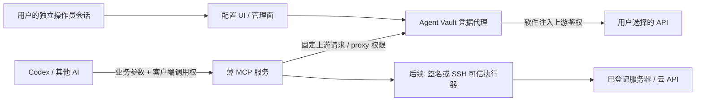

# 最小方案与路线图

## 推荐形态

**一个用户管理的凭据代理服务，复用现成配置界面；一个薄 MCP 工具服务；CLI 和 Skill 后续共用同一调用能力。** 独立桌面软件先作为可能的包装形式，不先造完整平台。

首个候选组合是 **Infisical Agent Vault + FastMCP + 少量可信适配器**。先验证这两个组件能否满足凭据边界，再决定是否采用。Agent Vault 的独立二进制、UI 和默认 SQLite 适合少量个人连接；MITM 代理使它比普通反向代理多一层 CA 配置，因此这项复用也要计算实际成本。依据：[Agent Vault README](https://github.com/Infisical/agent-vault)、[FastMCP 仓库](https://github.com/PrefectHQ/fastmcp)。

## 五种形式不是互斥选择

| 形式 | 适合承担的工作 | 单独解决凭据隔离？ | 建议 |
| --- | --- | --- | --- |
| 独立软件 / Web 配置 UI | 用户录入、替换凭据，选择连接与允许能力 | UI 需背后服务和独立身份；同权限桌面程序不能自动保密 | 先复用 Agent Vault UI；等流程确认后再中文化或包装 |
| CLI | 无 MCP 的助手和普通脚本提交别名与业务参数 | 如果只呼叫代理就可保留边界；若本地读 Key 则不行 | P1/P2 添加薄客户端，不实现第二套凭据存储 |
| MCP | Codex 与其他支持 MCP 的助手发现工具、校验参数、取得结果 | 协议本身不隔离文件、进程或管理权限 | 首版调用入口，服务端只暴露业务工具 |
| 插件 | 打包安装 MCP/CLI/界面入口、分发连接说明 | 安装包不是安全边界 | 需求稳定后包装，先不做插件市场 |
| Skill | 提供操作说明、工具选择和示例 | Markdown 不能限制 shell 或网络，更不能保管 Key | 可选说明层；其中只写连接别名和非秘密参数 |

## 最小拓扑



图中 UI、代理、MCP 服务及后续执行器处于用户控制的可信服务环境；AI 运行环境在边界外。工具服务及其适配器不允许 AI 改写。两项服务可以共用一台小 VM 或独立机器，无需 Kubernetes、多副本、Redis、计费系统。

### 部署边界怎样选

| 环境 | 能承诺什么 | 条件 |
| --- | --- | --- |
| AI 与代理同一 OS 用户 | 降低 Key 进入提示词/工具结果的机会 | **不能宣称 AI 无法读 Key**，只适合不带真实凭据的开发 |
| 同一机器，独立服务用户 | 可以形成可执行的身份权限边界 | AI 无 sudo/调试/该服务目录和数据库读写权；服务代码、配置、管理身份都不可被 AI 控制 |
| 隔离 VM 或独立机器 | 更容易解释和核验凭据边界，优先考虑 | 不共享密钥卷；不给 AI VM 管理、部署、管理 shell 或管理会话 |

另一个普通进程仍在相同用户权限内时不构成强隔离。容器如果挂入同一个用户目录、挂 Docker socket 或给宿主管理权，也会失去边界。管理员浏览器由 AI 自动化控制时，同样可能扩大授权或重配目标；“独立界面”必须与“AI 可控制的管理会话”分开。

### Agent Vault 组合的具体安排

这里是待验收的集成设计，不是已部署配置：

1. 用户在代理现有 UI 录入凭据、配置服务；仅操作员有管理/成员权限。
2. MCP 服务持有一个范围受限的代理身份，实例不授管理权，所需 vault 只授 `proxy`。AI 拿到的是 MCP 的调用能力，不能越过它去调用管理 API。
3. MCP 服务的 HTTP client 使用 Agent Vault 代理，CA 仅信任在这个 client/进程里；不修改用户系统根证书、不全局设置用户 `HTTPS_PROXY`，不修改已有项目。
4. 代理与 MCP 服务之间使用本机 loopback 或可信私网。Agent Vault 的 forward proxy 链路本身不能当作公网加密通道；若跨网络则需现成 VPN/加密隧道。对外 MCP 使用独立 TLS 和客户端身份。
5. 服务规则固定 host、端口和必要路径；不使用泛域名覆盖。薄 MCP 再限制具体 operation 和参数。未匹配目标可设为 deny，避免代理误用；这用于防止凭据被注入错误目标，不是业务内容出网控制。

角色、代理网络特性和服务匹配依据：[权限文档](https://docs.agent-vault.dev/learn/permissions)、[安全文档](https://docs.agent-vault.dev/learn/security)、[服务文档](https://docs.agent-vault.dev/learn/services)。管理员可导出凭据，因此不能给调用身份管理员 token。

### 如果 Agent Vault 不适合

在固定版本的假密钥验证中，如果其管理隔离、响应回显处理或 client 局部 CA 配置不满足要求，先排查配置；仍有明显缺口则换成一个**显式请求代理**：用户 UI 写入隔离存储，MCP 在可信进程里构造固定请求并调用 `AuthInjector`。继续复用成熟加密存储/系统身份和 OAuth 库，不发明加密算法。

替代方案仍保持相同业务工具接口。是否值得写这个小代理，取决于修补/适配现成方案的工作量；现在不决定写完整产品，也不先 fork 大型平台。

## 工具表面保持小

首轮最多开放下列几类，不必一次实现完：

| 工具 | AI 可给的参数 | 服务端决定 / 保存 |
| --- | --- | --- |
| `connections_list` | 无或类型过滤 | 返回别名、能力、已配置状态；不返回凭据或管理 URL |
| `llm_chat` | `connection_alias`、业务消息、已允许的模型别名 | provider、地区、model ID、origin、鉴权 |
| `embedding_create` | 别名、文本、允许的维度 | 上游接口和 Key |
| `speech_synthesize` | 别名、文字、音色枚举 | 音频协议、资源标识和鉴权；返回音频/文件结果 |
| `media_submit` / `media_status` | 别名、已登记任务类型、业务参数 / 任务 ID | 创建/查询 API、任务与连接绑定 |
| `server_action` | 服务器别名、动作名、枚举参数 | IP/主机、端口、账号、主机指纹、私钥、固定远端动作 |

少量接口也可以采用 `operation_call(connection_alias, operation_id, arguments)`，但 `operation_id` 必须来自已登记清单；**不接受 `url`、任意 method/path/Header、shell 命令或 SDK 代码**。偏业务的工具通常更易用。

客户端身份从 MCP/CLI 会话取得，不能相信 AI 参数中的 `user_id` 或角色字符串。别名不构成授权，服务应检查“这个调用身份可以操作这个别名和 operation”。

## 文档驱动适配，减少逐平台重复开发

### 优先级

1. 厂商已有标准接口：复用 HTTP/官方 SDK，编写很小的 capability preset。
2. 有 OpenAPI：导入生成候选 schema，筛选并包装操作。
3. 只有官方网页或保存文档：AI 在**不含真实凭据**的环境中整理候选 OpenAPI/manifest，由用户在配置阶段激活；执行服务只运行固定版本的受信模板。

线上文档用于研发，不在每次调用时让 AI 临时读取网页并发任意请求。保存文档不等于保存密钥。

### 三份很小的记录

下面只是格式草案，不是可部署配置；未含真实秘密。

```yaml
provider:
  id: deepseek
  docs_url: https://api-docs.deepseek.com/
  reviewed_date: '2026-10-06'
  origin: https://api.deepseek.com:443
  auth_kind: bearer
  allowed_operations: [chat]
  # 具体模型 ID 从用户已选 API 产品与当前文档登记

connection:
  alias: deepseek-main
  provider: deepseek
  credential_ref: store-only-reference
  status: configured

operation:
  id: chat
  method: POST
  path: /chat/completions
  input_schema: reviewed-business-schema
  auth_source: connection
  follow_redirects: false
```

`provider/operation` 是非秘密定义，`connection` 引用服务内的凭据记录。AI 可以看到可用 schema，但不能改可信服务所运行的定义。也不要把 `credential_ref` 设计成可由任意调用身份读取的 KV 路径。

### OpenAPI 导入的最小步骤

1. 保存官方来源、抓取日期、文档/规范 hash 与版本；加载 `$ref` 时仅允许已登记来源或已保存本地文件。
2. 固定 `servers` 与地区/租户绑定；关闭调用参数里的 base URL override。
3. 识别 security scheme；把 Key、Authorization、Cookie、refresh token、SSH 密钥字段从模型可见参数中移除。
4. 明确 allowlist 需要的 operation，最后 catch-all 拒绝；不默认开放接口全量。
5. 禁止凭据读取/导出、token endpoint、代理管理、任意 callback 目标等被当作普通 AI 工具；需要 OAuth 的部分由可信后台运行。
6. 不执行 OpenAPI description 或保存网页内的指令。用 mock 样例核对请求与响应，不静默激活新版本。

可复用：[FastMCP 的 OpenAPI 生成和 catch-all EXCLUDE](https://gofastmcp.com/integrations/openapi)。它也允许声明的 Header 参数参与请求，因此导入前后都要检查模型是否可以影响鉴权槽位。

### 不能靠 Header 模板解决的协议

| 协议 | 为什么需要小适配器 | 推荐处理 |
| --- | --- | --- |
| OAuth | 要处理授权回调、refresh、失效、scope | token endpoint 固定；后台保管 code verifier、client secret、refresh token；只向 AI 返回连接状态 |
| HMAC / 云 SDK 签名 | 签名与请求体、时间、路径、Header 绑定 | 官方 SDK 在可信执行器内签名。先用 dummy Key 签名再代理替换 Key **不能保证签名正确** |
| WebSocket / 二进制语音 | 握手后还有二进制帧、流式事件和状态 | 小 worker 封装官方协议；首轮可选非实时 HTTP TTS 降低复杂度 |
| 异步图片/视频 | 提交只返回 task ID，要后续轮询/取文件 | `submit` + `status`，服务绑定任务与连接；不要把上游认证状态串回 AI |
| SSH | 不是 HTTP Header 注入 | 可信执行器持私钥、验证主机指纹；只运行预设远端动作 |

如果后台 SDK 需要读取明文 Key，读取发生在可信执行服务内，仍可以满足“AI 不持有 Key”。但这意味着后台本身是信任边界，不能把 SDK 脚本交给 AI 任意改写。

## 只为凭据泄露保留的控制

| 泄露通道 | 简单可行的默认控制 |
| --- | --- |
| 同权限读文件/改代理 | 独立身份/VM/机器；数据库、代码、配置、CA 私钥、管理会话不在 AI 权限内 |
| 任意 URL/端口/Header | 由 operation 固定 origin、method、path；不接受覆盖基址、Host、鉴权头、Cookie 或代理配置 |
| 绝对路径、编码、DNS 绕过 | 拼接后解析并核对实际 URL；禁止跳出登记 origin；必要时固定目标/IP 策略，阻断元数据凭据端点 |
| 重定向 | 默认不跟随。确需重定向的特定协议才逐跳核对目标，跨 origin 不携带凭据；错误只返跳转失败类别 |
| 请求/错误转储 | 不打印完整请求、鉴权 Header、query Key、环境、curl 重现命令或含秘密的堆栈；日志默认只记别名、operation、状态、请求 ID |
| 上游回显 Key | 避开 echo/debug/token/export 端点；优先取已知响应字段；最后一道检查已知凭据及常见编码，命中则拒绝输出并记安全事件 |
| 流式响应/文件 | 同样纳入输出检查；不能因为是 SSE/WebSocket/binary 而把鉴权错误原样转发 |
| OAuth refresh | refresh/token 操作只在后台，完整 token 响应不进入工具结果或日志 |
| 代理 token 越权 | 区分客户端调用身份、代理 proxy 身份和管理身份；可撤销；AI 无权扩大自身授权 |
| 插件/适配器更新 | AI 可产出候选文件，可信服务不自动加载 AI 可写目录中的代码；固定版本后再启用 |

已知密钥匹配只能补救常见回显，不能证明可以识别任意变换/拆分后的秘密；因此固定接口、禁止 token/echo 端点是首要条件。对于仅需在 query/body 带鉴权的厂商，只有小适配器明确指定字段位置，不能提供面向 AI 的任意替换模板。

这个输出检查要在**持有凭据的代理内部**完成，或由代理提供不泄密的响应钩子；仅有 proxy 权限的 MCP 服务不知道密钥值，不应为了做脱敏而获得凭据导出权限。若固定 Agent Vault 版本无法满足回显负例，不能宣称组合已经安全：应限制为经核验的响应字段/接口，或采用显式请求代理的替代方案。首轮先用非流式响应验证；后续流式处理必须测试秘密跨事件/分块的情况，逐块字符串替换并不充分。

来源：[OWASP SSRF 防护](https://cheatsheetseries.owasp.org/cheatsheets/Server_Side_Request_Forgery_Prevention_Cheat_Sheet.html)、[MCP 安全实践](https://modelcontextprotocol.io/docs/draft/tutorials/security/security_best_practices)。这里的目标是保护凭据与调用身份；不检查正常业务内容是否应该发送给选定 API。

## 服务器首版做法

用户登记 `server-staging` 的地址、SSH 用户、端口、主机公钥指纹和独立 Key。AI 只调用例如：

```json
{"server_alias":"server-staging","action":"service_status","arguments":{"service":"web"}}
```

服务把 `web` 映射到已登记服务名。远端用独立低权限账号、`authorized_keys` 的 `restrict` 和 forced command/`ForceCommand` 进入一个固定 dispatcher；关闭 PTY、agent/port forwarding。dispatcher 把服务名等参数当枚举处理，不拼接 `sh -c`，不允许上传并执行任意脚本；其文件不可由该账号随意修改。

只读动作优先用结构化状态和有界日志。完整 `journalctl`、配置文件读取、环境查看也可能把远端其他 Key 输出，因此不是天然安全动作。日后启停服务只为特定系统动作加窄的权限；不要授通配 sudo 或 root shell。依据：[OpenSSH authorized_keys](https://man.openbsd.org/sshd.8)、[sshd_config ForceCommand](https://man.openbsd.org/sshd_config.5)。

如用户确实需要任意 shell，应另立授权模式并如实说明其权限，不能继续宣称远端其他秘密不会被 AI 读取。这不是首版默认功能。

## 分阶段路线图

本次完成到 R0；其余是下一阶段建议，尚未执行。

| 阶段 | 交付 | 进入下一步的条件 |
| --- | --- | --- |
| R0 文档探索 | 需求、候选和许可证、国内 API 核验、本文、来源证据 | 已完成文档交付；明确只控制凭据风险 |
| R1 假密钥验证 | 固定 Agent Vault 版本 + 一份 mock 上游 + 一个 MCP 业务工具；记录复用是否可行 | 请求注入成功；调用者读不了密钥/管理接口；错误、日志、重定向、回显负例通过 |
| R2 两个真实接口的小试点 | 用户已有账户的一个 Key API + 一个向量/TTS/异步任务；独立配置界面 | 仅在用户后续授权配置/部署后进行；不用开新账户；不影响原项目 |
| R3 文档适配 | 一个 OpenAPI 来源、一个保存文档来源生成候选定义 | 危险操作不激活；schema 没鉴权参数；版本变化可见 |
| R4 OAuth 和服务器 | 一个具体 OAuth 连接、一个服务器只读动作 | refresh 返回不泄 token；远端动作不读取任意配置/凭据；客户端可撤销 |
| R5 包装 | 中文 UI、CLI、插件/Skill 分发，少量预设连接 | 前四阶段的真实使用显示有重复安装/配置需求；再决定产品形态 |

**下一步最有价值的工作是 R1，不是扩展候选名单。** 先回答两个问题：Agent Vault 的现成 UI/proxy 在选定身份边界里够不够；“FastMCP 固定请求 → 本地 proxy → mock 上游”的组合是否能可靠过滤凭据泄露。用假密钥即可，不需要真实账户或费用。

首轮不要求多租户、RBAC 平台、账单、统计面板、全流量代理或内容审批。限额和高级审计按未来实际需求增加。
